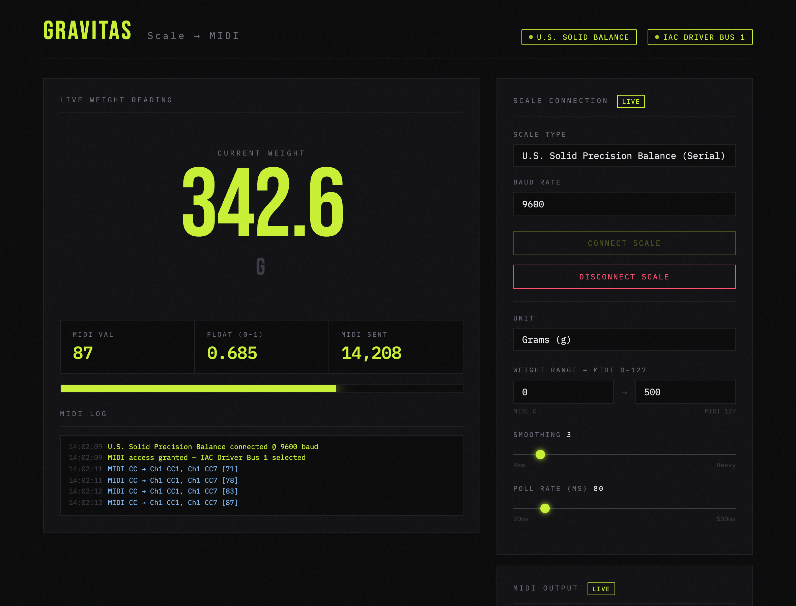
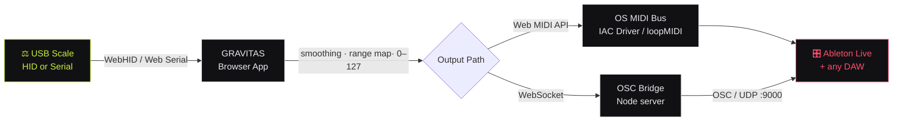
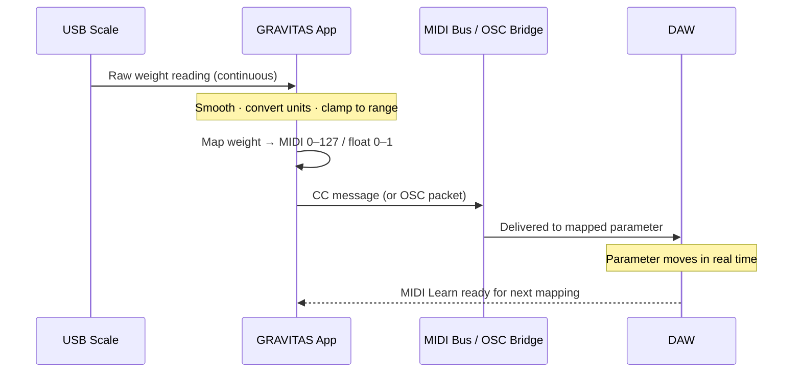
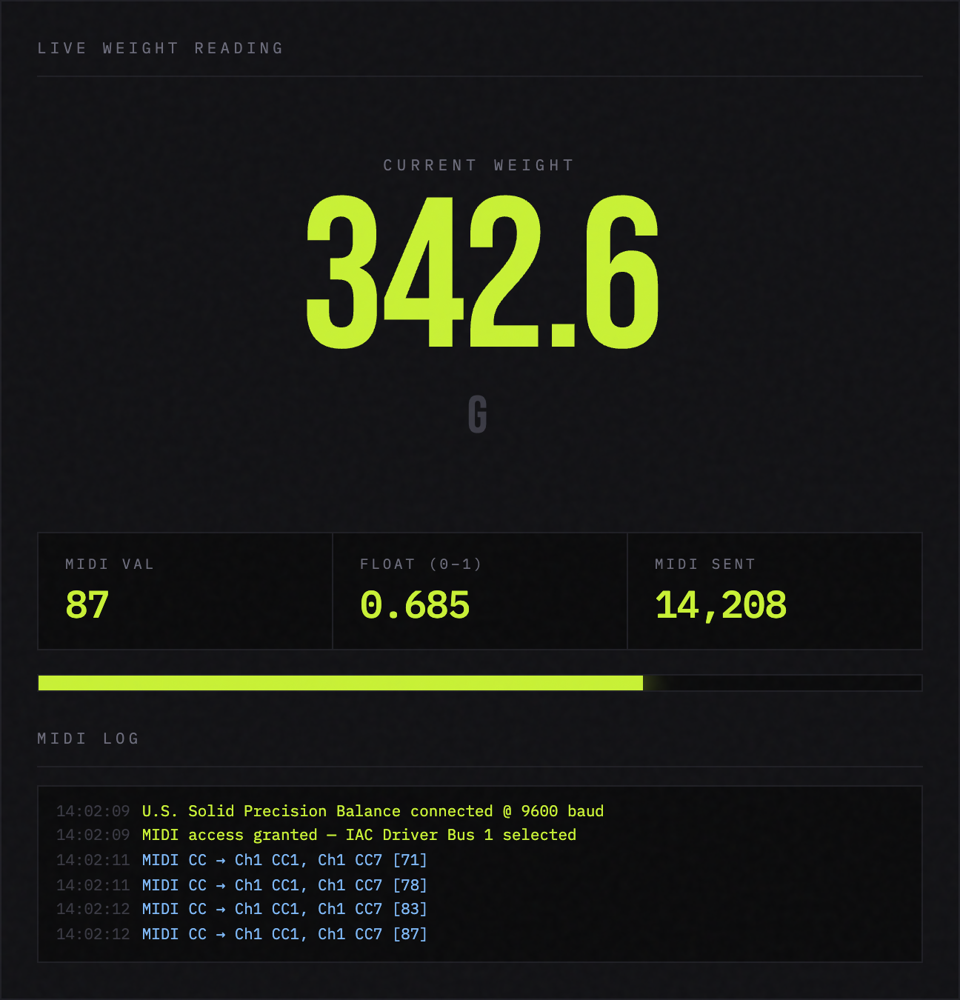
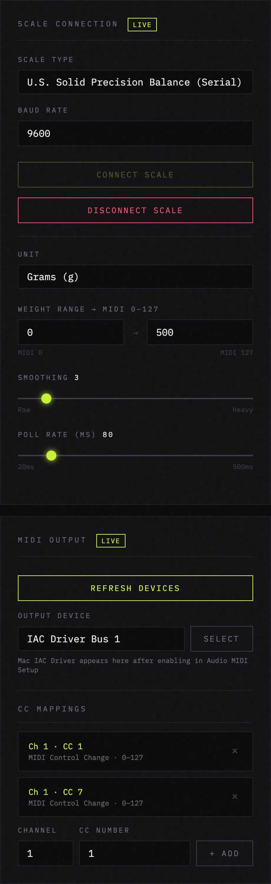

<div align="center">

# ⚖️ GRAVITAS

### Weight‑to‑MIDI Performance Controller

**Turn physical mass into musical control. GRAVITAS transforms any USB precision scale into a professional‑grade MIDI and OSC controller for Ableton Live and every major DAW — no drivers to write, no code to touch, no hardware to build.**

<br/>


<br/>



</div>

---

## Why GRAVITAS

Every studio already has a way to turn knobs. **Nobody has a way to play weight.**

GRAVITAS opens an entirely new performance gesture: pour, stack, press, lift, drain, crush. The physical world becomes your modulation source. A barista's pour controls a filter sweep. A sculptor's clay drives a reverb tail. A dancer stepping onto a platform rides the master fader. If it changes the reading on a scale, it changes your sound — in real time, with sub‑100‑millisecond response.

Built on modern browser hardware APIs, GRAVITAS runs entirely on the web platform. There is nothing to compile and nothing to install on the audio path. Open the app, connect your scale, pick your DAW destination, and perform.

---

## Capabilities at a Glance

| | |
|---|---|
| 🎚️ **Weight‑driven MIDI CC** | Map live weight to any MIDI Control Change, on any channel, to as many destinations as you like — simultaneously. |
| 🔌 **Universal scale support** | USB HID postal scales and serial lab balances work out of the box, plus a generic mode for virtually any scale on the market. |
| 🎛️ **Direct‑to‑DAW** | Sends standard MIDI over the OS MIDI bus (IAC Driver / loopMIDI) — instantly mappable with Ableton's MIDI Learn and every other DAW. |
| 🌐 **OSC bridge included** | Optional Node bridge forwards control data straight to **AbletonOSC** addresses over UDP for deep, parameter‑addressed control. |
| 📈 **Precision signal shaping** | Per‑session smoothing, adjustable poll rate, and a calibrated weight‑to‑range map keep output musical and jitter‑free. |
| 🖥️ **Studio‑grade interface** | A purpose‑built, high‑contrast control surface with a live weight stage, MIDI telemetry, VU metering, and an event log. |
| 📲 **Installable PWA** | Install to the dock or home screen and launch it like a native app — fully offline‑capable after first load. |
| ⚡ **Zero‑install signal path** | No kernel extensions, no proprietary drivers, no cloud account. Your data never leaves the machine. |

---

## How It Works

GRAVITAS reads your scale directly in the browser, shapes the signal, and delivers it to your DAW along the path that fits your workflow — a direct MIDI bus for instant mapping, or the OSC bridge for addressed parameter control.



**The signal journey, step by step:**



---

## Supported Hardware

GRAVITAS speaks two industry‑standard scale languages, covering the overwhelming majority of USB scales sold today.

| Scale | Connection | Protocol | Status |
|---|---|---|:---:|
| **DYMO S100** USB Postal Scale | WebHID | USB HID Weighing Device | ✅ Certified |
| **U.S. Solid Precision Balance** | Web Serial | ASCII over virtual COM (CH340 / CP2102 / FTDI) | ✅ Certified |
| **Any USB HID scale** | WebHID | Standard HID scale report | ✅ Generic profile |
| **Any serial‑output scale** | Web Serial | ASCII weight lines | ✅ Generic profile |

> The generic profiles are deliberately tolerant — GRAVITAS auto‑extracts the weight value from a wide variety of report layouts and serial line formats, so uncommon models usually work with no configuration.

---

## The Interface

A single, focused control surface — no menus to hunt through, no modes to learn.

### Live weight stage & MIDI telemetry

Read your performance at a glance: oversized live weight, the resolved MIDI value and normalized float, a running count of messages sent, a responsive VU meter, and a timestamped event log.



### Connection & mapping controls

Everything you need to go live sits in one column: scale selection and baud rate, unit choice, the weight‑to‑range calibration, signal smoothing and poll rate, MIDI output device selection, and unlimited CC mappings.



---

## Quick Start

Up and running in under two minutes.

### 1 · Launch GRAVITAS

Open `app.html` in **Google Chrome** or **Microsoft Edge** (the hardware APIs require a Chromium browser) — `index.html` is the product landing page. For a clean URL, serve the folder:

```bash
npx serve .
```

> 💡 **Install it.** Click the install icon in the address bar to add GRAVITAS to your dock or home screen as a standalone app.

### 2 · Connect your scale

1. Plug the scale in via USB.
2. Choose your model from **Scale Type**.
3. For serial balances, confirm the **Baud Rate** (9600 suits most U.S. Solid models).
4. Click **Connect Scale** and pick the device from the browser prompt.

The status pill turns **volt‑green** and the weight stage goes live.

### 3 · Route MIDI to your DAW

**macOS** — enable the IAC Driver in *Audio MIDI Setup → Window → Show MIDI Studio → IAC Driver → "Device is online."*
**Windows** — install [loopMIDI](https://www.tobias-erichsen.de/software/loopmidi.html) and create a port.

Then in GRAVITAS: click **Request MIDI Access**, select your virtual bus as the **Output Device**, and add any **CC mappings** you want to drive.

### 4 · Map it in Ableton

Enable the IAC Driver / loopMIDI port as a **Track** input in *Preferences → Link/Tempo/MIDI*, hit **MIDI Map Mode** (`⌘M`), click a parameter, and move weight on the scale. Done.

---

## Optional: OSC / AbletonOSC Bridge

For addressed, parameter‑precise control, GRAVITAS ships with a lightweight WebSocket→OSC bridge that forwards data straight to **AbletonOSC** over UDP.

### Install the bridge

```bash
# one-time
npm install ws osc

# start it
node osc-bridge-server.js
```

Expected output:

```
✅ OSC UDP ready → 127.0.0.1:9000
🌐 WebSocket bridge listening on ws://localhost:8080
```

### Install AbletonOSC in Live

- **Recommended:** [AbletonOSC](https://github.com/ideoforms/AbletonOSC) — copy to your *MIDI Remote Scripts* folder and enable under *Preferences → MIDI → Control Surface*.
- **Alternative:** any Max for Live device with `udpreceive 9000`.

### Common OSC addresses

| Address | Target |
|---|---|
| `/live/track/1/volume` | Track 1 volume |
| `/live/master/volume` | Master volume |
| `/live/track/1/send/0` | Track 1, Send A |
| `/live/device/1/parameter/1` | Device parameter |

**Port reference** — AbletonOSC listens on **9000** and replies on **11000**. To target a different port, edit `OSC_PORT` in `osc-bridge-server.js`.

---

## Signal‑Shaping Reference

| Control | What it does | Range |
|---|---|---|
| **Weight Range** | Maps `min → max` grams onto MIDI `0 → 127` | any g |
| **Smoothing** | Rolling‑average window — higher values glide, lower values track instantly | 1 (raw) → 20 (heavy) |
| **Poll Rate** | How often weight is sampled and sent | 20 – 500 ms |
| **Unit** | Display and input unit | g / oz / lb |
| **CC Mappings** | Unlimited channel + CC destinations, all driven at once | Ch 1–16, CC 0–127 |

---

## System Requirements

| | |
|---|---|
| **Operating system** | macOS, Windows, or Linux |
| **Browser** | Google Chrome or Microsoft Edge (Chromium) — *Firefox and Safari do not expose the required hardware APIs* |
| **DAW** | Ableton Live, or any DAW that accepts MIDI CC |
| **Node.js** | v18+ — *only for the optional OSC bridge* |
| **Scale** | Any supported USB HID or serial scale (see above) |

---

## Troubleshooting

<details>
<summary><strong>Scale doesn't appear in the picker</strong></summary>

- Plug the scale in **before** clicking Connect.
- Confirm the correct **Scale Type**; try a **Generic** profile if your model isn't listed.
- Swap USB port/cable.
- On Linux, add a udev rule for your vendor ID:
  - DYMO: `SUBSYSTEM=="hidraw", ATTRS{idVendor}=="0922", MODE="0666"`
  - CH340 serial: `SUBSYSTEM=="tty", ATTRS{idVendor}=="1a86", MODE="0666"`
</details>

<details>
<summary><strong>Serial / U.S. Solid scale won't connect</strong></summary>

- On macOS, install the **CH340** or **CP2102** USB‑to‑serial driver if no port appears.
- Verify the **baud rate** (most U.S. Solid models use 9600).
- Put the scale in **continuous / auto‑send** print mode in its settings menu.
- Confirm data flow with a serial terminal (CoolTerm, Serial) if needed.
</details>

<details>
<summary><strong>Weight isn't changing</strong></summary>

- Confirm the scale is powered (most draw power over USB).
- Check the browser console for HID report errors.
</details>

<details>
<summary><strong>MIDI / OSC isn't reaching the DAW</strong></summary>

- **MIDI:** confirm the IAC Driver / loopMIDI port is online *and* enabled as an input in your DAW.
- **OSC:** confirm the bridge is running and AbletonOSC is active in the Control Surface list. Test UDP with `nc -u 127.0.0.1 9000`.
</details>

---

## Technical Appendix

<details>
<summary><strong>USB HID scale report format</strong></summary>

```
Byte 0: Report ID
Byte 1: Status (0=stable, 1=fault, 4=positive overweight, 5=negative)
Byte 2: Unit   (2=g, 11=oz, 12=lb)
Byte 3: Scaling exponent (signed; -1 = ÷10)
Byte 4: Weight LSB
Byte 5: Weight MSB
```

`Weight = (Byte5 << 8 | Byte4) × 10^(Byte3)`
</details>

<details>
<summary><strong>Serial scale output format</strong></summary>

```
ST,GS,+  123.45,g      stable, gross, positive, grams
US,GS,+    0.02,g      unstable reading
+  123.45 g             simple format
   0.00 g               zero reading
```

GRAVITAS extracts the first signed decimal value from each line, making it resilient to format variation across brands.
</details>

---

<div align="center">

### GRAVITAS v2.1

**WebHID · Web Serial · Web MIDI · OSC**

*A new instrument for anyone with a scale and a reason to play it.*

Built by **Max Fishman**

</div>
